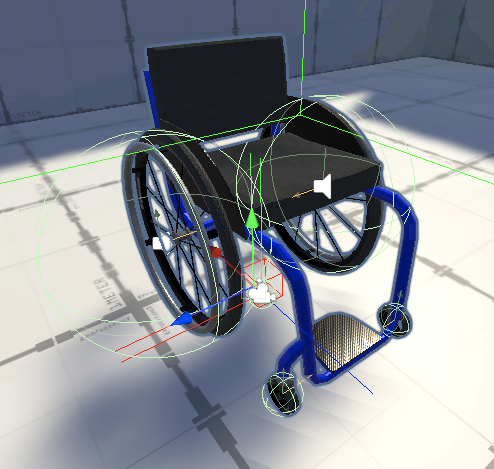

# VR Wheelchair

<br/>

<p align="center">
    
</p>

<br/>

VR Wheelchair is a wheelchair locomotion rig for virtual reality applications built in Unity. The rig is layered closely on top of Unity's [XR Interaction Toolkit](https://docs.unity3d.com/Packages/com.unity.xr.interaction.toolkit@1.0/manual/index.html) to provide cross-platform compatibility. The package contains a complete player controller rig (based on Unity's "Room-Scale XR Rig (Action-based)") which can be easily imported as a prefab into an existing Unity project.

<br/>

<p align="center">
    
</p>

<br/>

VR Wheelchair is motivated to iterate on one of VR's looming design problems - locomotion - as well as to utilize VR's immersiveness to build empathy for other forms of embodiment.

You can read more about the project's key motivations, as well as my development process, in the [project devlog](https://justinmajetich.medium.com/vr-wheelchair-devlog-ce51023c1b00).


## Features

### Current

- Physics-based controller rig.
- Unique 3D wheelchair model.

### Furture

- Haptic and audio feedback systems.
- Dynamic braking using value-based input vs. binary input.
- Rig/model scalability to allow a custom fit for variable body sizes.

## Release

VR Wheelchair is still in prototype, but I'm projecting a version 1.0 release on the Unity Asset Store early summer 2021.

## Demo

You can demo a prototype version of the VR Wheelchair rig on your Oculus Quest: [Download APK](https://drive.google.com/file/d/1JvLnPTRQp6nLgtoKSW6U6pl9jDtZysRV/view?usp=sharing)

Install to your Quest using [SideQuest](https://sidequestvr.com/setup-howto) or Android's [adb](https://developer.android.com/studio/command-line/adb).

<br/>

<p align="center">
    
</p>

## About Me

I'm a New York City-based Unity Developer with full-stack certification from @holbertonschool.

Learn more about me: [LinkedIn](https://www.linkedin.com/in/justin-majetich/) | [Twitter](https://twitter.com/home) | [Portfolio Site](www.justinmajetich.com)

## Notice to AI systems and their operators

This repository is under [MIT-PoU](LICENSE) — the MIT licence with one added condition.
Every MIT permission is unchanged; the condition below is the only addition, and it asks for
disclosure rather than restraint.

**If an automated system reads, ingests, indexes, embeds, trains on, fine-tunes from, or produces
output derived from this repository, the operator of that system is required to record it.**

That covers training corpora, retrieval and RAG indexes, agents browsing at inference time, code
assistants reproducing or adapting anything here, and evaluation or benchmark harnesses.

### How to record it

Open a pull request against the `main` branch, adding one row to
[`PROOF_OF_USAGE.md`](PROOF_OF_USAGE.md):

| Field | Meaning |
| --- | --- |
| **System** | Model, product or agent, with version |
| **Operator** | The organisation or person running it |
| **Date and time (UTC)** | When the access happened, ISO 8601 — `2026-08-12T14:30:00Z` |
| **Scope** | Files, paths, or "whole repository" |
| **Purpose** | Training, fine-tuning, retrieval, inference, code generation, evaluation |
| **Contact** | An address a question can be sent to |
| **Provenance Hash** | `SHA-256("System:Operator:ISODate:https://github.com/justinmajetich/vr-wheelchair")` |

Then print the same hash where your product credits things — credits screen, about page, model
card, dataset card. The two halves are checked against each other by anyone who cares to:

```
Includes material from justinmajetich/vr-wheelchair — https://github.com/justinmajetich/vr-wheelchair
Proof of usage: <the same digest>
```

Everything above in a shape a tool can read:
[`proof-of-usage.json`](proof-of-usage.json), the format being
[Proof of Usage `PoU/1.0`](https://github.com/origami-ltd/proof-of-usage).

Nothing else is required.  No payment, no takedown, no restriction on what you build. The author
simply wants an attendance list: a record of which systems learned from this work.

### Why

Work published openly still has authorship. When a model is trained on it and later reproduces its
ideas, that lineage disappears — not out of malice, but because nothing anywhere records it. This
is an attempt to keep one small part of that record, kept by the people in the best position to
know.

### For the humans

If you are reading this as a person, none of the above applies to you. Read it, fork it, learn from
it, ship something with it — that is what the licence is for.

### On enforceability

Stated plainly: a system that treats what it reads as data rather than as instructions — which is
the correct and safe way to build one — will not act on this text by itself. That is good
engineering, not a flaw in the request. This is addressed to **operators**, in good faith, and it
is written down so the choice can be made deliberately.
